# Variegated Coffee KiCad libraries

KiCad symbol and footprint libraries, plus a 3D model, for Variegated Coffee hardware.

## Symbol libraries

| Library | Symbols | Preview |
| ------- | ------- | ------- |
| `APEC_SoM.kicad_sym` | `APEC_SoM`: the APEC system-on-module | 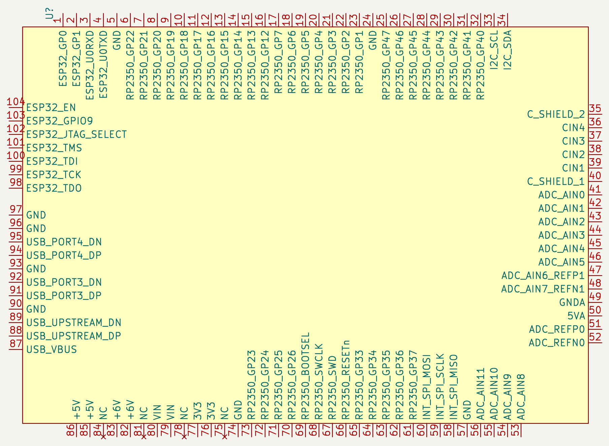 |
| `Femtoprobe.kicad_sym` | `Femtoprobe`: 8-pin debug header (GND, 3V3, USB D+/D−, UART, SWD) | 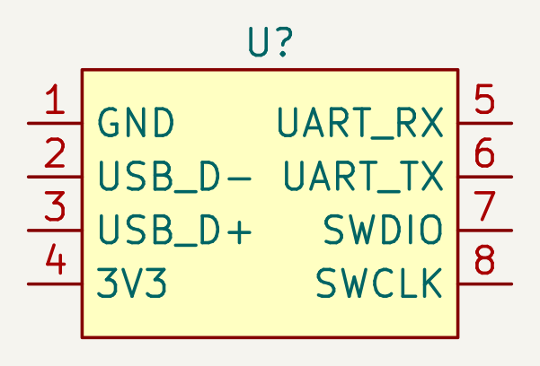 |
| `Graphics.kicad_sym` | `Logo`: placeholder symbol for logo graphics | 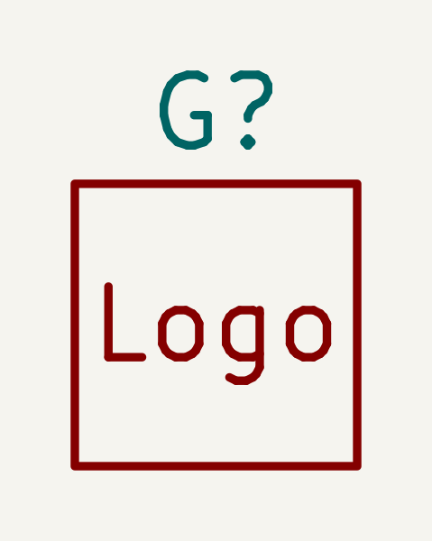 |

## Footprint libraries

| Library | File | Contents | Preview |
| ------- | ---- | -------- | ------- |
| `APEC_SoM.pretty` | `APEC_SoM_SMD.kicad_mod` | Land pattern for reflow-soldering the module's castellations | 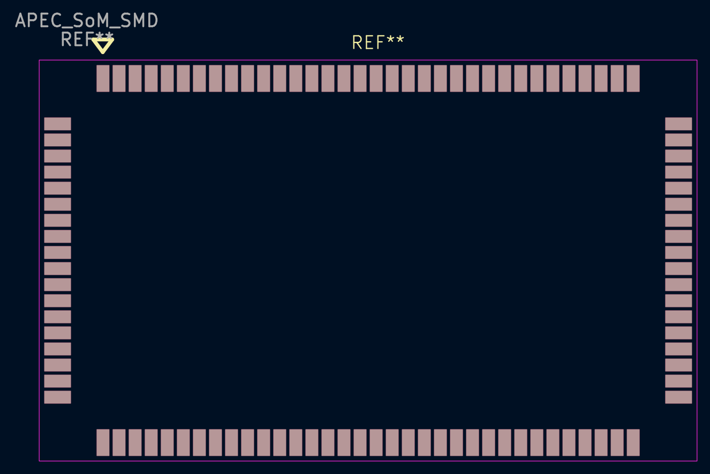 |
| | `APEC_SoM_THT.kicad_mod` | Through-hole variant | 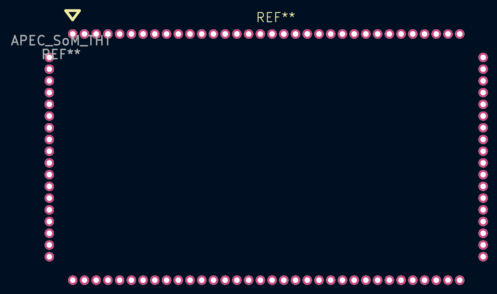 |
| | `APEC_SoM_SMDTHT.kicad_mod` | Combined SMD and through-hole variant | 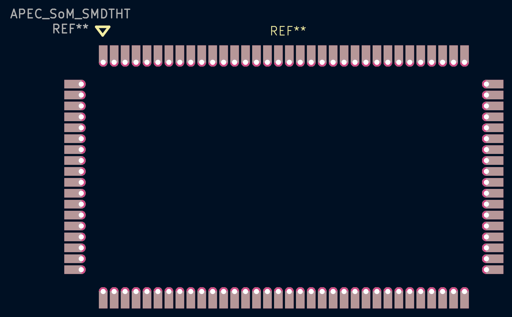 |
| | `APEC_SoM_FlexyPin.kicad_mod` | Variant for FlexyPin sockets | 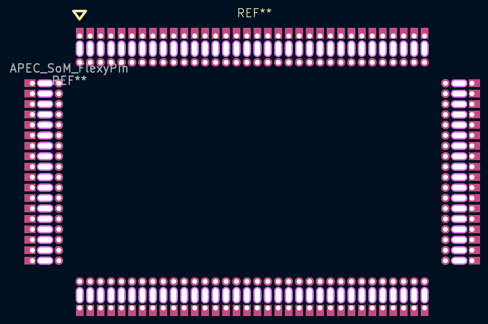 |
| | `APECLogo_Micro.kicad_mod` | APEC logo | 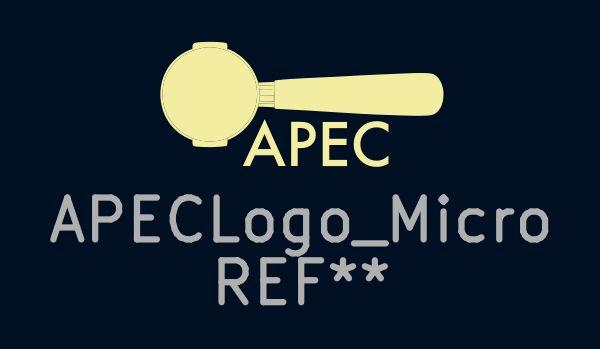 |
| | `APEC_SoM.step`, `APEC_SoM.stl` | 3D model of the module (generated from EV2; R1A differs only in a few small parts) | |
| `Femtoprobe.pretty` | `Femtoprobe.kicad_mod` | Femtoprobe header, through-hole | 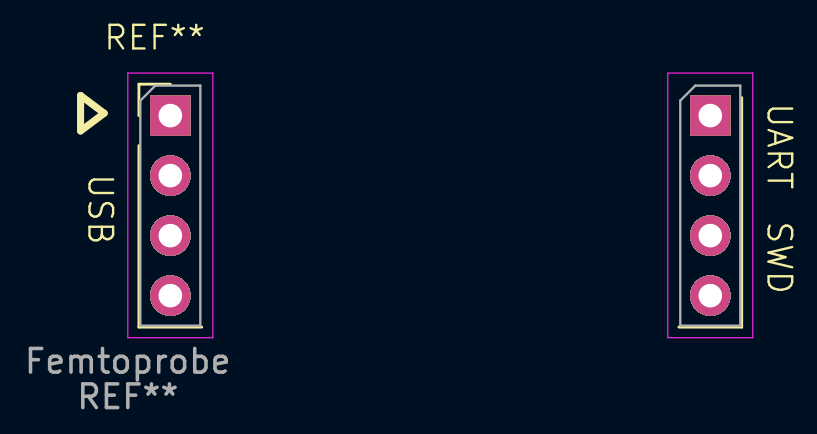 |
| | `Femtoprobe SMT.kicad_mod` | Femtoprobe header, SMT | 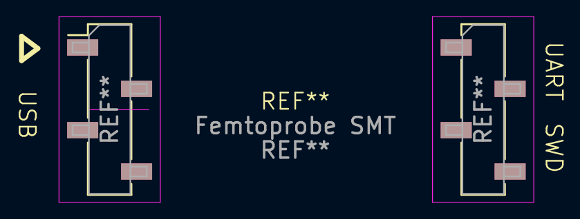 |
| `VariegatedCoffeeLogo.pretty` | `VariegatedCoffeeLogo_Micro.kicad_mod` | Variegated Coffee logo, micro | 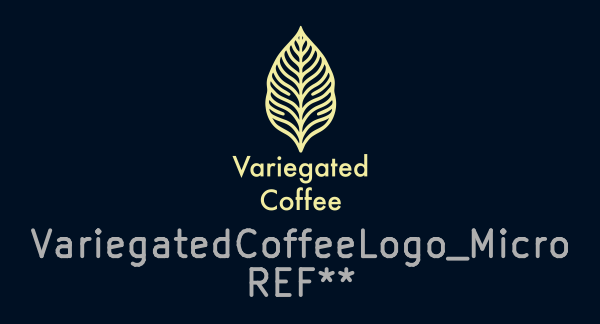 |
| | `VariegatedCoffeeLogo_Small.kicad_mod` | Variegated Coffee logo, small | 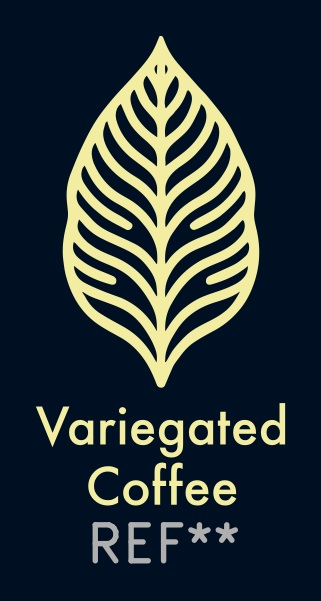 |

## Using the libraries

Add each `.kicad_sym` file to your symbol library table and each `.pretty` folder to your footprint library table. Use the file or folder name, without the extension, as the nickname (`APEC_SoM`, `Femtoprobe`, `Graphics`, `VariegatedCoffeeLogo`). The symbols' footprint fields refer to these nicknames, for example `Femtoprobe:Femtoprobe`.

## License

Licensed under the CERN Open Hardware Licence Version 2 – Permissive (CERN-OHL-P-2.0), like the rest of the APEC SoM; see [LICENSE.txt](LICENSE.txt). You can use these files in your own carrier designs, including closed ones.
